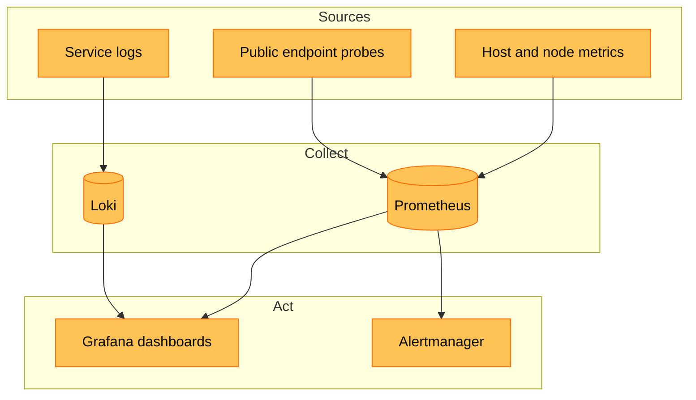
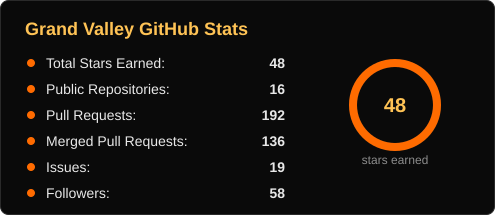
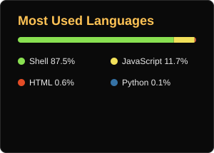
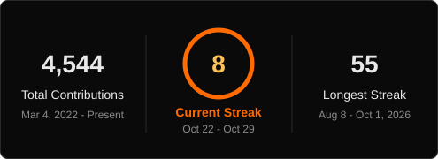

  

  <h1>Grand Valley</h1>
  
<strong>Fervent Proof of Stake Validator</strong>

  
An independent validator and open-source infrastructure team. We secure networks, write the guides we wish we had, and ship tools that take the pain out of running a node.

  

    <a href="https://grandvalleys.com"><strong>Website</strong></a> ·
    <a href="https://x.com/bacvalley"><strong>X</strong></a> ·
    <a href="https://medium.com/@grandvalley"><strong>Medium</strong></a> ·
    <a href="https://github.com/hubofvalley/Testnet-Guides"><strong>Guides</strong></a> ·
    <a href="mailto:letsbuidltogether@grandvalleys.com"><strong>Contact</strong></a>
  

---

## 🧭 Find Your Way

| You are | Start with |
|---|---|
| **Choosing a validator** to delegate to | [0G validator profile](https://explorer.0g.ai/app/validators/0x108e619da0cdba8a301a53948a4acc23a3d79377/delegators) · [grandvalleys.com](https://grandvalleys.com) · [Email us](mailto:letsbuidltogether@grandvalleys.com) |
| **Setting up your own node** | [Valley toolkits](#-valley-toolkits) · [Testnet Guides](https://github.com/hubofvalley/Testnet-Guides) · [Mainnet Guides](https://github.com/hubofvalley/Mainnet-Guides) |
| **Bringing a network to life** and need an operator | [Email us](mailto:letsbuidltogether@grandvalleys.com) |

## 🛠️ Our Work

| Focus | How we deliver it |
|---|---|
| **Securing networks** | We operate validators on supported chains. Our mainnet validator profile lives on [0G](https://explorer.0g.ai/app/validators/0x108e619da0cdba8a301a53948a4acc23a3d79377/delegators). |
| **Building tools** | Each *Valley of ...* toolkit is a menu-driven terminal app that installs, upgrades and inspects a node, with snapshots, peers, status and logs a keypress away. |
| **Writing guides** | Hands-on walkthroughs for mainnet and testnet, plus an archive of earlier networks we have supported. |
| **Watching the stack** | Prometheus, Grafana, Loki, Alertmanager, Grafana Alloy, Node Exporter and Blackbox Exporter. |
| **Sharing knowledge** | Explainers and calculators on [grandvalleys.com](https://grandvalleys.com) and [Medium](https://medium.com/@grandvalley). |

## 🔭 Under the Hood

Metrics, probes and logs land in one place. Dashboards show what is happening, and alert rules decide who hears about it.

## 🌐 Valley Toolkits

Every network gets its own toolkit, with a menu-driven launcher and its own documentation.

| Network | Mainnet | Testnet |
|---|---|---|
| **0G** | [Valley-of-0G-Mainnet](https://github.com/hubofvalley/Valley-of-0G-Mainnet) | [Valley-of-0G-Testnet](https://github.com/hubofvalley/Valley-of-0G-Testnet) |
| **Gno.land** | [Valley-of-Gnoland-Mainnet](https://github.com/hubofvalley/Valley-of-Gnoland-Mainnet) | [Valley-of-Gnoland-Testnet](https://github.com/hubofvalley/Valley-of-Gnoland-Testnet) |
| **Story Protocol** | [Valley-of-Story-Mainnet](https://github.com/hubofvalley/Valley-of-Story-Mainnet) | [Valley-of-Story-Testnet](https://github.com/hubofvalley/Valley-of-Story-Testnet) |
| **Namada** | [Valley-of-Namada-Mainnet](https://github.com/hubofvalley/Valley-of-Namada-Mainnet) | n/a |
| **Limonata** | n/a | [Valley-of-Limonata-Testnet](https://github.com/hubofvalley/Valley-of-Limonata-Testnet) |
| **Worrell** | n/a | [Valley-of-Worrel-Testnet](https://github.com/hubofvalley/Valley-of-Worrel-Testnet) |
| **Tempo** (legacy) | n/a | [Valley-of-Tempo-Testnet](https://github.com/hubofvalley/Valley-of-Tempo-Testnet) |

> A toolkit tells you we maintain tooling and documentation for a network. It does **not** mean Grand Valley sits in that network's active validator set. Check the network's own explorer for that.

**Good habits:** read any script before running it, run it as the regular user that owns the node (never root), keep keys and mnemonics to yourself, and rehearse changes on a non-validator node first.

## 📈 Contribution Pulse

Generated from public GitHub data by a scheduled workflow in this repository, refreshed daily.

## 💌 Say Hello

  

Thinking of delegating, stuck on a node, or about to launch a testnet and need an operator who has done it before? Drop us a line.

[**Website**](https://grandvalleys.com) · [**Email**](mailto:letsbuidltogether@grandvalleys.com) · [**X**](https://x.com/bacvalley) · [**Medium**](https://medium.com/@grandvalley) · [**Guides**](https://github.com/hubofvalley/Testnet-Guides)

**Let's Buidl Together**

